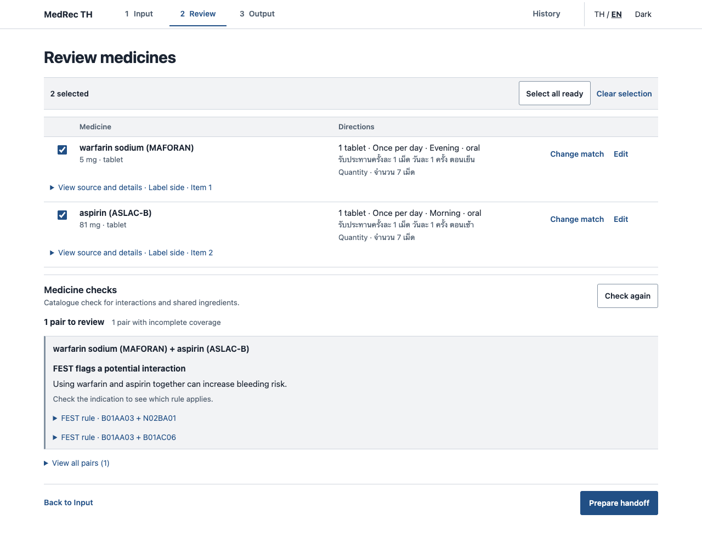
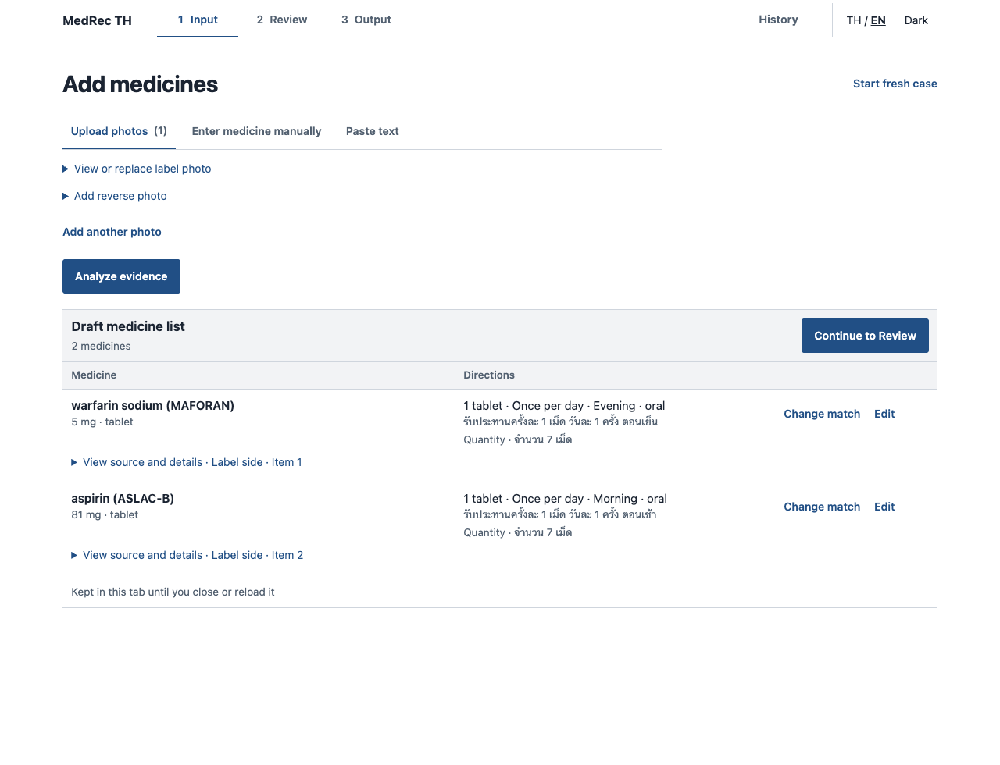

# MedRec TH · Medication Reader

MedRec TH is a medication reconciliation prototype for Thai pharmacy staff, built during an OpenAI hackathon. It turns medication labels, pasted records, and Thai Medicines Terminology (TMT) selections into an editable list. A pharmacist can check the list and copy it into a hospital system or download structured JSON.



[Watch the walkthrough](docs/demo/walkthrough.gif) · [Try the demo](docs/demo/README.md) · [Run locally](#run-locally)

The walkthrough shows live OpenAI extraction from two marked synthetic labels, followed by the local catalogue and interaction checks.

## Workflow

| Stage | What you get |
| --- | --- |
| **Input** | Upload one photo of several label sides, add an optional reverse view, paste a record, or search TMT by brand, ingredient, or code. Photos and text can prefill the same medicine rows used by manual entry. |
| **Review** | Edit the product, directions, dose, frequency, time of day, and quantity. Open the original label or text beside the extracted fields. Run optional interaction and shared-ingredient checks and see which pairs remain unassessed. |
| **Output** | Choose the rows to hand off, then copy a tab-separated list or download JSON. Completed handoffs can be reopened from History on the same browser. |

<details>
<summary>Animated walkthrough and additional screenshots</summary>





</details>

## Run locally

Use Python 3.12 and either Node.js 22.13+ in the 22.x series or Node.js 24. From the repository root, start FastAPI.

```sh
python3.12 -m venv .venv
. .venv/bin/activate
python -m pip install -e "backend[test]"
python tools/local_screening/install.py
python -m uvicorn app.main:app --host 127.0.0.1 --port 8000
```

In a second terminal, start Vite.

```sh
cd frontend
npm ci
npm run dev -- --host 127.0.0.1
```

Open [the app on port 5173](http://127.0.0.1:5173). Manual entry, the bundled catalogue, and the checks work without an OpenAI key. To try photo or text analysis, follow the [analysis setup and sample](docs/demo/README.md#read-a-thai-label-photo).

**First run without a key.** Under **Enter medicine manually**, look up TMT product codes `108354` (MAFORAN, warfarin sodium) and `250763` (ASLAC-B, aspirin) and add each to the draft. In Review, choose **Check medicines**. The installed FEST references produce a potential bleeding-risk finding with **Partly assessed** coverage. Then choose the rows and prepare a handoff. This is a synthetic software demonstration.

## How it works

- **React and TypeScript** handle intake, row editing, and the handoff. Original photos, pasted notes, and unfinished rows live in the tab. The app’s History keeps completed medication summaries and timestamps in browser storage. Original images, notes, and facility contacts stay out of History.
- **FastAPI and the OpenAI Responses API** locate labels, transcribe evidence, and propose structured fields. The backend validates fields against the cited evidence and checks product candidates against TMT. The provider receives submitted evidence for photo or text analysis.
- **SQLite** supplies the offline TMT and FEST lookup. For eligible oral products that lack an exact formulation match, the checker can follow published links to the therapeutic ingredient and FDA UNII synonyms. Findings show the source, any conditions, and the coverage gaps.

This hackathon prototype supports pharmacist review. It covers a historical TMT release and a pinned FEST release. Patient-specific applicability and uncovered pairs still require review. The default workspace prepares a handoff for manual entry. A [separate staff fixture](docs/specs/reconciliation-contract.md#admission-encounters) demonstrates mock hospital import.

## Documentation and checks

- [Demo walkthrough and synthetic label image](docs/demo/README.md)
- [Workflow diagram and field contracts](docs/specs/medication-reader-v1.md)
- [Screening coverage and reproduction steps](docs/data/local-screening.md)
- [Reference data, attribution, and terms](reference-data/README.md)
- [Frontend development and browser tests](frontend/README.md)

```sh
python -m pytest -q backend/tests tools/local_screening
npm --prefix frontend run lint
npm --prefix frontend run build
```
