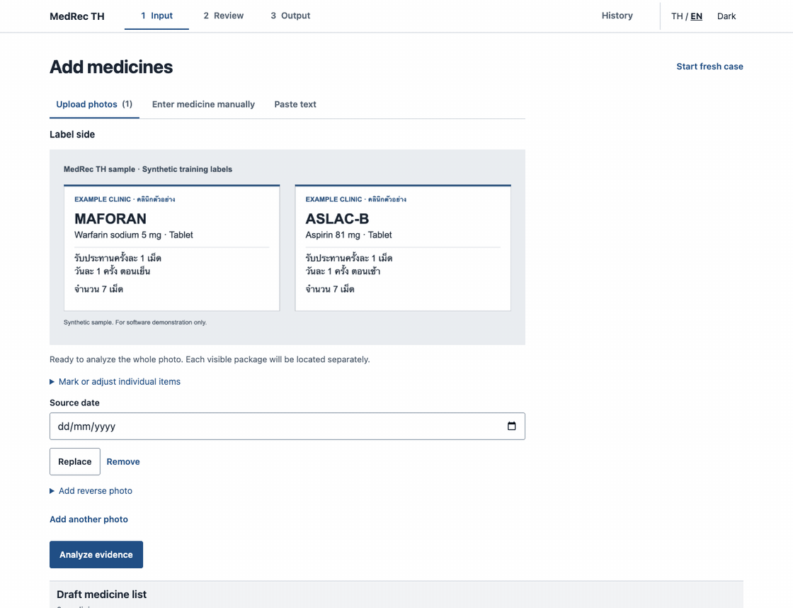
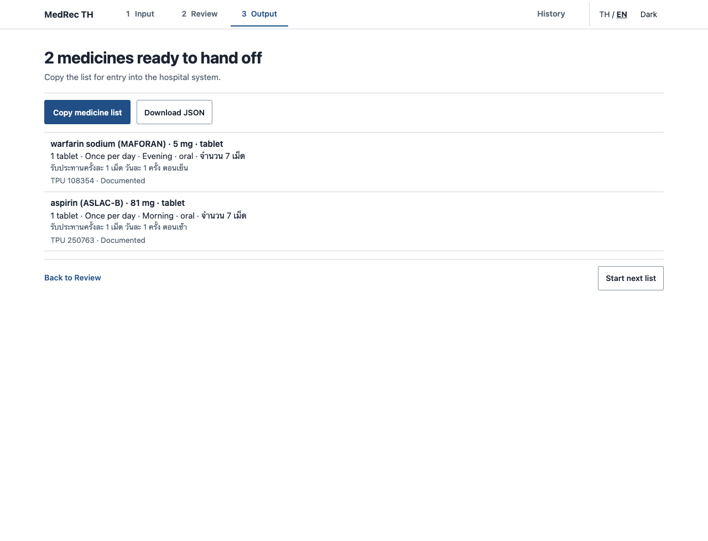

# MedRec TH · Medication Reader

MedRec TH is a medication reconciliation prototype for Thai pharmacy staff, built during an OpenAI hackathon. It turns medication labels, pasted records, and Thai Medicines Terminology (TMT) selections into an editable list. A pharmacist can check the list and copy it into a hospital system or download structured JSON.


[Watch the walkthrough](docs/demo/walkthrough.gif) · [Try the demo](docs/demo/README.md) · [Run locally](#run-locally)

The walkthrough shows live OpenAI extraction from two marked synthetic labels, followed by the local catalogue and interaction checks.

## Workflow

| Stage | What you get |
| --- | --- |
| **Input** | Upload one photo of several label sides, add an optional reverse view, paste a record, or search TMT by brand, ingredient, or code. Photos and text can prefill the same medicine rows used by manual entry. |
| **Review** | Edit the product, directions, dose, frequency, time of day, and quantity. Open the original label or text beside the extracted fields. Run optional interaction and shared-ingredient checks and see which pairs remain unassessed. |
| **Output** | Choose the rows to hand off, then copy a tab-separated list or download JSON. Completed handoffs can be reopened from History on the same browser. |

<details>
<summary>Animated walkthrough and additional screenshots</summary>






</details>

## Run locally

Use Python 3.12 and either Node.js 22.13+ in the 22.x series or Node.js 24. From the repository root, start FastAPI.

```sh
python3.12 -m venv .venv
. .venv/bin/activate
python -m pip install -e "backend[test]"
python tools/local_screening/install.py
python -m uvicorn app.main:app --host 127.0.0.1 --port 8000
```

In a second terminal, start Vite.

```sh
cd frontend
npm ci
npm run dev -- --host 127.0.0.1
```

Open [the app on port 5173](http://127.0.0.1:5173). Manual entry, the bundled catalogue, and the checks work without an OpenAI key. To try photo or text analysis, follow the [analysis setup and sample](docs/demo/README.md#read-a-thai-label-photo).

**First run without a key.** Under **Enter medicine manually**, look up TMT product codes `108354` (MAFORAN, warfarin sodium) and `250763` (ASLAC-B, aspirin) and add each to the draft. In Review, choose **Check medicines**. The installed FEST references produce a potential bleeding-risk finding with **Partly assessed** coverage. Then choose the rows and prepare a handoff. This is a synthetic software demonstration.

## How it works

- **Read the labels.** FastAPI uses the OpenAI Responses API to find packages in a photo, then reads up to three crops in parallel. Each draft row links back to its crop. If one crop fails, the other rows can still be reviewed. [Photo processing](backend/app/services/scene_analysis.py)
- **Extract the directions.** The model returns fixed fields with supporting quotes. For example, `วันละ 3 ครั้ง` supports three doses per day. `เช้า เที่ยง เย็น` fills the morning, noon, and evening slots. Python checks each proposed value against the quoted text and preserves the original wording for review. [Label validation](backend/app/services/label_directions.py)
- **Match the product.** The backend queries the local TMT catalogue by name and narrows the results using any strength and form on the label. The model can choose from that shortlist. When the match is unclear, the pharmacist can select a product or keep the entry unmatched. [Catalogue matching](backend/app/services/catalogue_identity.py)
- **Check the list.** SQLite looks up interactions in the pinned FEST dataset and checks for shared TMT substance IDs separately. If an exact formulation is missing, the interaction checker can use an ingredient match for supported oral forms with compatible route evidence. The report shows the source rules and marks pairs it could not assess. [Screening details](docs/data/local-screening.md)

The React and TypeScript client uses the same editable rows for manual entry and model suggestions. Submitted photos and text go to OpenAI for analysis. The draft stays in tab memory, and browser History stores completed medication summaries and timestamps. Original photos, pasted notes, and facility contacts stay out of History.

This hackathon prototype supports pharmacist review. It covers a historical TMT release and a pinned FEST release. Patient-specific applicability and uncovered pairs still require review. The default workspace prepares a handoff for manual entry. A [separate staff fixture](docs/specs/reconciliation-contract.md#admission-encounters) demonstrates mock hospital import.

## Documentation and checks

- [Demo walkthrough and synthetic label image](docs/demo/README.md)
- [Workflow diagram and field contracts](docs/specs/medication-reader-v1.md)
- [Screening coverage and reproduction steps](docs/data/local-screening.md)
- [Reference data, attribution, and terms](reference-data/README.md)
- [Frontend development and browser tests](frontend/README.md)

```sh
python -m pytest -q backend/tests tools/local_screening
npm --prefix frontend run lint
npm --prefix frontend run build
```
