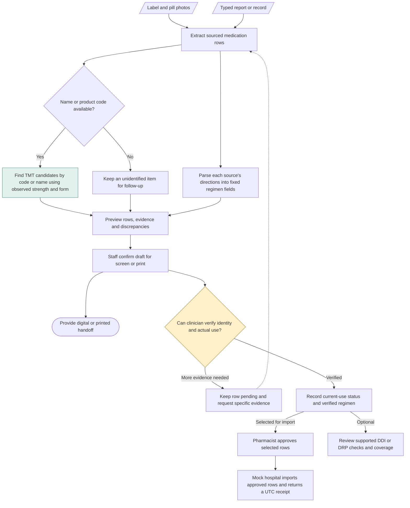

# Medication reconciliation v1 design

## Problem and users

ช่วยเภสัชกรรวบรวมประวัติยาจากหลายแหล่งก่อนส่งต่อหรือสั่งยาครั้งถัดไป เอกสารอาจมาไม่ครบ ผู้ป่วยอาจนำยามาเพียงบางส่วน และเภสัชกรต้องกรอกข้อมูลซ้ำจากคลินิก โรงพยาบาล หรือหอผู้ป่วย

During urgent intake or a transfer, the referring clinic's medication list may be unavailable. The receiving team may have a ward record, only some of the patient's medicines, and a patient or caregiver who is uncertain about what was taken. Staff need to identify the source of each entry and what they still need to confirm.

In the fixture-only, 12-hour Medication Reader demo, community and hospital pharmacists, clinic staff, and nurses gather histories and evidence. A pharmacist or doctor verifies current use for this encounter. The draft keeps printed directions, reported use, and reviewer-verified current use distinct. [WHO technical report on medication safety in transitions of care](https://www.who.int/publications/i/item/WHO-UHC-SDS-2019.9)

## Workflow

1. A staff member opens a transient case. For **Photo 1**, keep available items in their original packaging or in separate groups on a plain background, including bags, boxes, blister packs, and loose or unlabeled items. Face the labels up and make the text readable in the frame. Staff can also add medicines manually during intake, including medicines the patient reports but did not photograph. Record the source and date when available. For optional **Photo 2**, flip the same bags or packs to show the pills where visible. Keep the items in their original positions so the two photos can be matched. Allow either photo to be retaken. Attach a source to each photo or supplemental manual record. Capture the evidence type, organization or reporter, department or ward, contact, and source date when available. Flag missing source details for follow-up. The demo uses `ศักดาเวชการ` and the masked contact `075-356XXXX`.
2. Automatically read Thai, English, and bilingual labels from **Photo 1** and suggest one row per item or inseparable group. Capture the medication name, dose, indication, regimen or directions, amount prescribed, prescriber, and prescriber contact when explicitly documented. Also capture strength, dosage form, and expiry when visible. Preserve the original text, numerals, units, and dates and link each field to its evidence. Keep the dose separate from product strength and the amount prescribed separate from the number of pills visible. Leave missing or unreadable fields blank and allow the reviewer to fill them from a documented source. Keep undocumented indication, prescriber identity, and contact details unknown. Preview suggestions for staff confirmation before updating the draft.
3. Give unlabeled items and items whose identity is unreadable a stable placeholder such as **Unknown medication A**, with an **Unlabeled** or **Unreadable** status. Match the same item across the photos and attach its crop from **Photo 2** when the match is supported. If pills are hidden or the match is uncertain, keep the row pending and ask the reviewer to match the images or retake the photo. A reviewer may inspect loose-pill descriptors and synthetic reference candidates. Require independent evidence to confirm identity.
4. Show conflicting values side by side with their sources and ask for the specific missing evidence. Provide the same dated draft as a digital review list and a print-friendly list. Both show medication details, evidence references, reported use, discrepancies, follow-up items, and each matched Photo 2 crop beside its unknown item. Show a missing-image note when a crop is unavailable. The print layout includes space for verification and notes. The digital view links back to the photos and supports corrections. Drafts and unresolved rows carry visible status labels in both formats.
5. A pharmacist or doctor reviews the list with the patient or caregiver and uses other source records as needed. For each row, confirm identity and record whether the patient currently takes it, no longer takes it, or has uncertain use at this encounter. For current medications, record the actual dose, route, and frequency as verified, separately from the printed directions. Record who verified the row, when, and which evidence supports it. Keep unresolved discrepancies pending and record any medicines missing from the photos. Clinical decisions and advice remain with the reviewer.
6. The mock hospital import requires explicit pharmacist approval and valid source evidence for every selected row. Keep ineligible rows pending and show what remains after a partial import. Return the mock hospital's UTC import timestamp after success and save only that timestamp in local history. Timestamp searches may return multiple results for staff to disambiguate. Reloading restores the history and clears the draft.

If evidence suggests a label may belong to a different medicine, show the original transcription and the conflicting evidence with their sources. Keep the row pending until a clinician verifies identity against independent evidence and documents the resolution. Pharmacist approval is still required before import.

### Fixed fields for directions

The proposed extraction produces one record per medication, source and schedule component. Every record has the same fields. `basis` is `documented` for a label or record, `reported` for a patient or caregiver account, or `verified` after clinician review. Only the first two can be generated during extraction.

| Field | Type | Synthetic label example |
| --- | --- | --- |
| `row_id`, `component_id` | case-local identifiers | `med-A`, `schedule-1` |
| `basis` | enum | `documented` |
| `parse_status` | complete, partial or unparsed | `complete` |
| `unparsed_text` | unrepresented wording or null | `null` |
| `directions_text` | original source text | `1 tablet each morning` |
| `dose_amount` | decimal or null | `1` per administration |
| `dose_unit` | normalized unit or null | `tablet` |
| `schedule_type` | frequency, interval or null | `frequency` |
| `frequency_count` | positive integer or null | `1` administration per period |
| `period_value` | positive number or null | `1` |
| `period_unit` | hour, day, week, month or null | `day` |
| `time_of_day` | list of named times or explicit clock times | `[morning]` |
| `route` | normalized route or null | `null` |
| `meal_relation` | normalized meal instruction or null | `null` |
| `as_needed` | boolean or null | `null` |
| `evidence` | source and optional item reference on each populated clinical field | Photo 1, label region A |

“Each morning” supplies once per day and a morning administration. Route, breakfast timing and an exact clock time require separate evidence. If the patient identifies this package and says “I take it in the evening,” create a separate reported record. Fill only the evening timing, link it to the statement and flag the difference. An ambiguous “it” stays unassigned until staff identify the medicine. Verification records actual use at this encounter.

For different morning and evening amounts, create two components with their respective doses and timing. Frequency applies to each component. For “every 8 hours as needed for pain,” use interval mode, an 8-hour period, a blank frequency count and `as_needed = true`. Keep “for pain” in `unparsed_text` and mark the parse partial. Preserve unrepresented ranges, limits and taper phases in the same way. Print the original wording alongside a partial parse and request clarification where needed.

### Outputs through the workflow

| Stage | Output |
| --- | --- |
| Intake | A transient case with text evidence, images or both. Label-side and optional reverse-side photos can be paired. A staff question is a request, separate from evidence. |
| Extraction | Sourced medication names, labeled strengths and forms, directions records and stable placeholders for unknown items. Each populated value links to the source statement or located image region. |
| Product lookup | Search Thai Medicines Terminology (TMT) using a product code or observed name with strength and form when available. Display the original evidence beside candidate trade names, ingredients, strengths, forms and manufacturers. Preserve zero, multiple or conflicting results for review. A loose pill alone stays unresolved. Show “No match in the February 2020 catalogue” for an empty result. Independent case evidence can still establish identity. Attach a TPU only to a confirmed trade product. |
| Draft | After staff confirmation, print or display the same dated rows, discrepancies, crops and follow-up questions. |
| Verification | A pharmacist or doctor records identity, current-use status, actual regimen and supporting evidence. For a confirmed catalogue match, keep the TPU code as a string and the release version. Product strength and dispensing unit describe the reference product. The patient's regimen comes from case evidence. Carry a verified stopped medicine in the history with its status. Exclude it from the active list. |
| Mock import | A pharmacist explicitly approves selected row revisions. Successful import returns row IDs and a UTC timestamp. Pending rows stay visible. Only the successful import timestamp enters local history. |

**Implementation status.** The fixed regimen fields above extend the current backend schema. Today, documented directions are a sourced text observation and verification contains sourced dose, route and frequency. The local TMT lookup works with release TMTRF20200217. The diagram shows its proposed place in the workflow. Public demo cases use synthetic fixtures. [Analysis schema](../../backend/app/schemas/analysis.py) · [Verification schema](../../backend/app/schemas/review.py) · [Catalogue release and scope](../data/tmt-2020.md)

## Medication agent analysis form

Provide the medication agent as a required v1 feature through labeled boxes in the intake and review workspace. Include **Photo 1 — Label side**, **Photo 2 — Reverse side**, and **Additional medication photos** upload boxes, plus free-text boxes for **Patient-reported use**, **Other source notes**, and **Questions for the agent**. Staff can write naturally in Thai, English, or a mix, and submit photos, text, or both using **Analyze evidence**. Keep each field's role and source metadata when sending it to FastAPI. Display the result alongside the form as suggested medication rows, discrepancies, and follow-up items. Staff can adjust the inputs and run another analysis.

Accept readable, unreadable, and unlabeled items in the same upload. Read visible labels using the shared extraction flow. Give items without a readable identity stable unknown IDs. A single unlabeled image supports appearance observations only. Require evidence of a match before attaching a reverse-side crop to an item.

**Always show the medication source.** Each medication entry in the analysis results, digital draft, and printed list has a visible **Source** and cites the evidence for each populated field. Identify the photo and its label or crop, the document, or the patient, caregiver, or reviewer report. Show the organization or reporter, date, and contact when documented. For an unlabeled bag with unknown dispensing provenance, show both **Source — Photo 2, unlabeled bag** and **Dispensing source — Unknown**. Leave unsupported values unknown and ask for the evidence needed to verify them. Keep conflicting sources visible and distinguish printed directions, reported use, and reviewer-verified use.

Staff can ask what a label says, which sources disagree, or what to verify next in **Questions for the agent**. Treat that field as a request and the report and source-note fields as evidence. Submit only relevant inputs and evidence from the open case. Validate structured output and check that its row and source IDs belong to the case before display. Keep inputs, attachments, and results in memory. Ask staff to confirm suggestions before updating the draft. Staff verify actual use and approve imports through the existing review controls. Refer treatment questions to the pharmacist or doctor. The agent can explain an existing validated DDI/DRP summary and its coverage. A failed analysis preserves form inputs, the existing draft, and the print workflow for retry.

## AI prompts and verification

Version the label extraction, pill description, and form analysis prompts in the FastAPI backend. Specify field roles, observable medication fields, required source IDs, unknown or unreadable states, and treatment-question handling. Require per-medication provenance and evidence references on populated fields in structured output. FastAPI validates the response before displaying it and withholds unsupported or invalidly cited claims.

Use synthetic labeled, unlabeled, mixed, and blurry images, bilingual labels, conflicting sources, text embedded in evidence that attempts to change the task, and responses with missing or out-of-case references. Run deterministic fixture tests in CI. Run a separate opt-in model smoke test on synthetic inputs and record the prompt version, model, and results. Verify source coverage and evidence correctness as well as name and directions transcription. A populated field with an unsupported source fails verification.

## Optional DDI and DRP summaries

The reviewer can request either a drug–drug interaction (DDI) summary or a drug-related problem (DRP) summary. The two-photo draft, the reviewer handoff, and pharmacist approval work with both summaries off. Enable a check only when a versioned, clinically validated reference or rule set is available for the intended scope. DDI checks require reviewer-verified current medications with supported normalized identities. DRP checks also require the verified regimen and any patient context specified by each rule. The model transcribes evidence and does not generate clinical findings. Synthetic fixtures can demonstrate the interface with simulated findings clearly labeled as demo data.

- Show the source or rule-set name and version, when the checks ran, the medications or pairs actually evaluated, and the DRP rules applied. Tie each possible finding to the affected rows and its supporting source or rule.
- Report skipped medications, pairs, or rules with reasons such as unresolved identity, missing patient context, unsupported products, or an unavailable or stale source. Distinguish **Not run**, **Unavailable**, **Partial coverage**, and completed checks. State “No findings within checked scope” only for the portion that actually ran and display any gaps alongside it. Keep medication verification independent of the summary and reserve completion status for the reviewer's own verification.
- Invalidate the summary when its medication list or required context changes. An exported summary, when the reviewer chooses to include it, carries the same scope, provenance, and gaps. The reviewer decides clinical relevance and any follow-up or treatment changes.

## Architecture and data ownership

| Component | Responsibility |
| --- | --- |
| TypeScript frontend | Staff-facing intake and analysis form, review, and print layouts. Call FastAPI through a typed client. Keep photos, form inputs, results, and review edits in memory. |
| FastAPI and Python | Own the application API under `backend/`, including multipart form analysis, label extraction, pill observations, candidate search, summary checks, and mock import. Use Pydantic models for validation and publish the OpenAPI contract consumed by the frontend. Keep the demo reviewer role and import authorization on the backend. |
| FastAPI OpenAI adapter | Sends synthetic fixture photos and case evidence for label transcription, appearance description, and medication form analysis. Validates model responses against the shared contract. Keep credentials server-side and use stateless requests with response storage disabled where supported. Review provider data controls before any real-data integration. [OpenAI API data controls](https://developers.openai.com/api/docs/guides/your-data) |
| Candidate search | Rank a small bundled catalog of fictional reference images using image similarity and observed imprint, shape, form, and color. Use known crops or manual selection for the demo. Return multiple plausible results or an unresolved state. |
| Import service and mock hospital DB | Validates approved rows and evidence server-side and writes the accepted snapshot to a fixture-only mock receiving system. Retries of the same approved import return the original timestamp without duplicate writes. A failed write leaves the draft available for retry and creates no local history entry. |
| Browser history | Store only successful UTC timestamps. Keep case UUIDs, filenames, source names, contacts, medication fields, images, and analysis inputs and results out of persistent browser storage, caches, analytics, and app logs. The mock hospital DB is the only demo store for reviewed medication records. |

## Demo scope

Demonstrate one transfer case with the label-side and reverse-side photos of the same items. Read a Thai/English label and confirm its preview to add it to the draft, leave an unreadable field blank, and show an unlabeled item with its reverse-side crop in both review formats. Include a difference between printed directions and what the patient reports. Verify that the reviewer can record actual use and that one approved row can be imported while a pending row stays out. With both summaries off, the review still works. A synthetic partial-coverage example shows a checked pair or rule, an omitted item, and the reason for the omission. Use synthetic fixtures throughout. Production authentication and hospital connectivity, clinic-specific rule sets, live DDI and DRP integrations, automated urgency assessment, symptom–drug associations, and longitudinal medication histories are future work.

## Post-hackathon roadmap

1. **Improve two-photo intake.** Test the current workflow with synthetic cases first. Evaluate the Decisions API for flagging blurry labels and possible mismatches between the two photos. Let staff retake a photo or continue with manual review. Keep uncertain matches pending and attach a pill crop only when the evidence supports the match.
2. **Add push-to-talk dictation.** If staff spend meaningful time typing patient reports, let them dictate what the patient says they actually take. Show the editable transcript before saving it as patient-reported use, separate from printed directions and reviewer-verified use. Test Thai speech mixed with English medication names, doses, and units before piloting dictation.
3. **Pilot guided voice interviews.** If dictation saves staff time, try GPT-Live for short follow-up questions about missing or conflicting information. A pharmacist or doctor reviews the captured answers and confirms any updates to the medication list.
4. **Evaluate clinical data separately.** Assess coverage of validated DDI references and DRP rules for the medications and patient context encountered in the intended setting. Offer optional checks where the team can establish and disclose coverage. Show what was checked and skipped, and leave clinical decisions with the reviewer.
5. **Evaluate product lookup coverage.** Test the lookup step above against labeled Thai and English fixtures. Measure missing products, ambiguous names, and strength or form disagreements before expanding catalogue coverage.

Roadmap issues: [#18](https://github.com/pakornds/Medication-Reader/issues/18), [#19](https://github.com/pakornds/Medication-Reader/issues/19), [#20](https://github.com/pakornds/Medication-Reader/issues/20), [#21](https://github.com/pakornds/Medication-Reader/issues/21), [#23](https://github.com/pakornds/Medication-Reader/issues/23).

## Hackathon judging and demo acceptance

Use the working prototype to show how a pharmacist or doctor prepares and verifies a transfer medication list from incomplete evidence. Within the 12-hour demo budget, prioritize the two-photo workflow, medication agent analysis form, and printable handoff. Show the optional DDI/DRP example after the core workflow.

| Judging criterion | Evidence to show |
| --- | --- |
| Problem & Solution Fit | Use a synthetic transfer case with a dispensing label, an unlabeled medicine, and a discrepancy between printed directions and patient-reported use. Show how the draft brings those sources together and gives the reviewer a specific follow-up for each gap. Ground the problem statement in medication reconciliation at transfers of care. |
| Build Quality | Run the two-photo and natural-language form flow from a fresh session through analysis, source-linked unknown-item review, verification of actual use, and the digital and printed handoff. Exercise the recovery checks below, and verify that judges can open the submitted prototype link. Label simulated DDI/DRP findings and mock hospital behavior in the demo. |
| Insight & Originality | Show the two-photo capture pattern in action. A matched reverse-side crop stays attached to a stable unknown-item row through the printed and digital handoff, so the reviewer can identify which physical item needs follow-up. Show how the draft keeps label directions, patient reports, and reviewer-verified use separate. |
| Real-World Value | Identify the beneficiaries and the work the prototype could save. Compare manual draft preparation with app-assisted preparation on the same synthetic case. Record time to prepare a reviewable draft, fields corrected by the reviewer, and unresolved items surfaced. Report the measured results and label them as a synthetic-case demonstration. |
| Alignment with Build Direction | Select at least one official build direction and tie it to a behavior judges can try. The proposed fit is AI-assisted intake with clinician verification, demonstrated by the two-photo draft and review. Confirm the official direction name from the event materials before finalizing the write-up. |
| Use of Codex | Show specific contributions from Codex to building the product. Record what Codex did, the resulting change or test, and how the team verified it. Use actual examples linked to commits or diffs where available. |

Use the following checks when implementing and verifying the demo. The issue numbers refer to the existing work areas below.

| Check | Acceptance criteria and work area |
| --- | --- |
| Photo pairing and recovery | Cover swapped positions, hidden pills, and a retake. Uncertain pairings keep the unknown row pending without attaching a crop. Retakes refresh affected matches and preserve unrelated draft entries. Intake and review ([#10](https://github.com/pakornds/Medication-Reader/issues/10), [#11](https://github.com/pakornds/Medication-Reader/issues/11), [#16](https://github.com/pakornds/Medication-Reader/issues/16)), verified end to end ([#17](https://github.com/pakornds/Medication-Reader/issues/17)). |
| Print and digital review | Both formats show the same unknown rows and matched crops. The digital review records who verified actual use and when. The printed list has room for reviewer notes. Review and workspace ([#11](https://github.com/pakornds/Medication-Reader/issues/11), [#16](https://github.com/pakornds/Medication-Reader/issues/16)), verified end to end ([#17](https://github.com/pakornds/Medication-Reader/issues/17)). |
| Medication agent analysis | Submit an image with a readable label and an unlabeled bag, with a natural-language patient report in a separate box. Verify both items show a source and the unlabeled item has an unknown ID. Verify the report retains its source and differs visibly from printed directions. Test photo-only and text-only submission, an unsupported claim, a treatment question, and a failed analysis. Analysis ([#14](https://github.com/pakornds/Medication-Reader/issues/14)), verified end to end ([#17](https://github.com/pakornds/Medication-Reader/issues/17)). |
| Optional DDI/DRP example | With both summaries off, complete the review. When a simulated check runs, show checked scope, skipped items or rules, and the reason. Editing the medication list or required context invalidates the result. Simulated checks ([#15](https://github.com/pakornds/Medication-Reader/issues/15)), verified end to end ([#17](https://github.com/pakornds/Medication-Reader/issues/17)). |
| Mock import recovery | Import only pharmacist-approved rows, keep unresolved rows visible, and recover from a failed write without duplicate records. Approval and import ([#9](https://github.com/pakornds/Medication-Reader/issues/9), [#12](https://github.com/pakornds/Medication-Reader/issues/12), [#16](https://github.com/pakornds/Medication-Reader/issues/16)), verified end to end ([#17](https://github.com/pakornds/Medication-Reader/issues/17)). |

## Hackathon submission requirements

The Regional Codex Hackathon Thailand submission slide calls for **one Google Form submission per team by 5:00 PM local event time** and states that late submissions are disqualified. Have one team member coordinate the submission using the organizer's form.

| Deliverable | Ready when |
| --- | --- |
| GitHub repository | The submitted link opens a **new public repository created for this hackathon**. Verify that a signed-out visitor can open it and that the public contents contain synthetic fixtures only, with no credentials or patient data. `pakornds/Medication-Reader` is the intended destination, subject to eligibility and visibility verification. |
| Project write-up | The write-up explains the medication reconciliation problem, the two-photo solution, the selected official build direction, and how Codex contributed. It includes observed demo results and distinguishes simulated findings from live features. |
| Demo link | The link opens a live demo or working prototype that judges can use to run the synthetic case. Verify access and the core workflow from a fresh browser session before submission. |
| Declarations | Identify any existing open-source software or personal projects used and state which work was built exclusively during the event. Record the copied `Medication-Reader-Agent` baseline at `d6a81c9`, identify which parts were reused, and confirm the event-only work against the project history. |

## GitHub tickets

The backend scaffold and API contracts are prerequisites. [#1](https://github.com/pakornds/Medication-Reader/issues/1) owns the initial FastAPI entry point and health route. Feature tickets implement their own routers. [#28](https://github.com/pakornds/Medication-Reader/issues/28) owns the router registry and mounts it in the running app once those routers are ready. It verifies HTTP dispatch and the published OpenAPI operations. Verify the shared model prompts before integrating label extraction, pill descriptions, and form analysis.

| Ticket | Depends on | Owned paths | Acceptance example |
| --- | --- | --- | --- |
| [#1](https://github.com/pakornds/Medication-Reader/issues/1) Scaffold the FastAPI backend | None | backend/pyproject.toml, backend/app/main.py, backend/tests/test_health.py, CI, AGENTS.md Commands | A clean checkout can start FastAPI and query the health route. Backend checks pass. |
| [#2](https://github.com/pakornds/Medication-Reader/issues/2) Define reconciliation contracts and synthetic fixtures | [#1](https://github.com/pakornds/Medication-Reader/issues/1) | backend/app/schemas/, backend/tests/fixtures/contracts/, backend/tests/test_contracts.py, docs/specs/reconciliation-contract.md | An analysis result names a medication without a valid source identifier → schema or evidence validation rejects the claim. |
| [#3](https://github.com/pakornds/Medication-Reader/issues/3) Add a mockable FastAPI OpenAI adapter | [#2](https://github.com/pakornds/Medication-Reader/issues/2) | backend/app/ai/client.py, backend/tests/ai/test_client.py | Simulated timeout → typed recoverable error; client import of server adapter fails. |
| [#4](https://github.com/pakornds/Medication-Reader/issues/4) Transcribe Thai and English labels from Photo 1 | [#3](https://github.com/pakornds/Medication-Reader/issues/3), [#22](https://github.com/pakornds/Medication-Reader/issues/22) | backend/app/api/labels.py, backend/app/services/labels.py, backend/tests/api/test_labels.py | Bilingual label with smudged expiry and absent contact → both names preserved, expiry unreadable, contact missing. |
| [#5](https://github.com/pakornds/Medication-Reader/issues/5) Describe visible pills from selected crops | [#3](https://github.com/pakornds/Medication-Reader/issues/3), [#22](https://github.com/pakornds/Medication-Reader/issues/22) | backend/app/api/pills.py, backend/app/services/pills.py, backend/tests/api/test_pills.py | Two crops with different shapes and one hidden imprint → separate descriptions, with the hidden imprint unknown. |
| [#6](https://github.com/pakornds/Medication-Reader/issues/6) Rank synthetic pill reference candidates | [#2](https://github.com/pakornds/Medication-Reader/issues/2) | backend/app/api/pill_candidates.py, backend/app/services/catalog.py, backend/tests/api/test_pill_candidates.py, fixtures/catalog/ | Two similar references → two unverified candidates; no match → unresolved with a follow-up. |
| [#7](https://github.com/pakornds/Medication-Reader/issues/7) Validate pharmacist approval and source evidence | [#2](https://github.com/pakornds/Medication-Reader/issues/2) | backend/app/services/import_eligibility.py, backend/tests/services/test_import_eligibility.py | A doctor verifies actual use but no pharmacist has approved import → row ineligible for import. |
| [#8](https://github.com/pakornds/Medication-Reader/issues/8) Store retry-safe records in the mock hospital | [#2](https://github.com/pakornds/Medication-Reader/issues/2) | backend/app/services/hospital.py, backend/tests/services/test_hospital.py | Concurrent identical retries → one record and one receipt timestamp; token with different data → conflict. |
| [#9](https://github.com/pakornds/Medication-Reader/issues/9) Connect approved rows to the mock import route | [#7](https://github.com/pakornds/Medication-Reader/issues/7), [#8](https://github.com/pakornds/Medication-Reader/issues/8) | backend/app/api/imports.py, backend/tests/api/test_imports.py | An eligible selected row plus an unselected unknown row → one write; selecting the unknown row → no write. |
| [#10](https://github.com/pakornds/Medication-Reader/issues/10) Build photo and natural-language evidence boxes | [#2](https://github.com/pakornds/Medication-Reader/issues/2) | src/components/intake/, tests/ui/intake/ | Staff add a paired photo and write in Thai that the patient only takes the medicine in the morning → both photos and the patient-report field retain their independent sources. |
| [#11](https://github.com/pakornds/Medication-Reader/issues/11) Build digital medication review and clinician verification | [#2](https://github.com/pakornds/Medication-Reader/issues/2) | src/components/review/, tests/ui/review/ | Label says twice daily and the patient reports mornings only → display both sources and keep the clinician-verified value separate. |
| [#12](https://github.com/pakornds/Medication-Reader/issues/12) Build pharmacist approval and import preview | [#2](https://github.com/pakornds/Medication-Reader/issues/2) | src/components/approval/, tests/ui/approval/ | A pending unknown row stays outside the preview; editing an approved row requires fresh approval. |
| [#13](https://github.com/pakornds/Medication-Reader/issues/13) Persist timestamp-only import history | [#2](https://github.com/pakornds/Medication-Reader/issues/2) | src/lib/history/, src/components/history/, tests/ui/history/ | Import receipt then reload → timestamp visible and draft empty; no photos, metadata, or analysis data persisted. |
| [#14](https://github.com/pakornds/Medication-Reader/issues/14) Serve source-grounded medication form analysis in FastAPI | [#4](https://github.com/pakornds/Medication-Reader/issues/4), [#5](https://github.com/pakornds/Medication-Reader/issues/5), [#22](https://github.com/pakornds/Medication-Reader/issues/22) | backend/app/api/medication_analysis.py, backend/app/services/medication_analysis.py, backend/tests/api/test_medication_analysis.py | In one image item A is labeled 5 mg and B is labeled 10 mg. A response assigns 10 mg to A and cites B’s valid crop → withhold that field and return a verification request. |
| [#15](https://github.com/pakornds/Medication-Reader/issues/15) Return optional simulated DDI and DRP checks from FastAPI | [#2](https://github.com/pakornds/Medication-Reader/issues/2) | backend/app/api/checks.py, backend/app/services/checks.py, backend/tests/api/test_checks.py | One supported pair and an unidentified item → one checked pair, a documented exclusion and partial coverage. Missing required context skips the affected DRP rule. |
| [#16](https://github.com/pakornds/Medication-Reader/issues/16) Assemble the two-photo reviewer workspace | [#10](https://github.com/pakornds/Medication-Reader/issues/10), [#11](https://github.com/pakornds/Medication-Reader/issues/11), [#12](https://github.com/pakornds/Medication-Reader/issues/12), [#13](https://github.com/pakornds/Medication-Reader/issues/13), [#24](https://github.com/pakornds/Medication-Reader/issues/24), [#25](https://github.com/pakornds/Medication-Reader/issues/25), [#26](https://github.com/pakornds/Medication-Reader/issues/26), [#27](https://github.com/pakornds/Medication-Reader/issues/27), [#28](https://github.com/pakornds/Medication-Reader/issues/28), [#34](https://github.com/pakornds/Medication-Reader/issues/34) | src/app/page.tsx, src/lib/workspace/, tests/workspace/ | Submit mixed images and a free-text patient report through Analyze evidence → preview sourced suggestions for confirmation; analysis failure preserves the form and draft. |
| [#17](https://github.com/pakornds/Medication-Reader/issues/17) Verify the end-to-end reconciliation demo | [#16](https://github.com/pakornds/Medication-Reader/issues/16) | tests/integration/ | Mixed label and patient report → named and unknown rows have distinct sources, reported use stays separate from printed directions, and all approved claims remain attributable. |
| [#18](https://github.com/pakornds/Medication-Reader/issues/18) Evaluate Decisions API for photo quality and pairing | [#17](https://github.com/pakornds/Medication-Reader/issues/17) | evaluations/photo-quality/ | Swapped synthetic pair → flag uncertain pairing for staff without attaching a crop. |
| [#19](https://github.com/pakornds/Medication-Reader/issues/19) Pilot push-to-talk for patient-reported use | [#17](https://github.com/pakornds/Medication-Reader/issues/17) | evaluations/dictation/ | Label says twice daily; recording says mornings only → editable reported use and visible discrepancy. |
| [#20](https://github.com/pakornds/Medication-Reader/issues/20) Evaluate GPT-Live for guided medication interviews | [#19](https://github.com/pakornds/Medication-Reader/issues/19) | evaluations/guided-interview/ | Patient report conflicts with the label → ask a follow-up and leave the verified field untouched. |
| [#21](https://github.com/pakornds/Medication-Reader/issues/21) Evaluate validated DDI and DRP data coverage | [#17](https://github.com/pakornds/Medication-Reader/issues/17) | evaluations/clinical-references/ | Unsupported product or missing rule context → documented coverage gap; no claim of complete coverage. |
| [#22](https://github.com/pakornds/Medication-Reader/issues/22) Write and verify medication AI prompts and source grounding | [#2](https://github.com/pakornds/Medication-Reader/issues/2) | backend/app/ai/prompts/, backend/tests/ai/test_prompts.py, backend/tests/fixtures/ai/, docs/ai/verification.md | Two distinct strengths appear in one photo. An answer swaps the labels while citing valid in-case IDs → the evaluation fails; correct field-to-label attribution passes. |
| [#23](https://github.com/pakornds/Medication-Reader/issues/23) Evaluate medication database cross-checks for label evidence | [#17](https://github.com/pakornds/Medication-Reader/issues/17) | evaluations/label-lookup/ | A label and the catalog agree on the name but disagree on strength → show both sources, flag the discrepancy, and leave the draft unchanged. |
| [#24](https://github.com/pakornds/Medication-Reader/issues/24) Preview and confirm agent suggestions | [#2](https://github.com/pakornds/Medication-Reader/issues/2) | src/components/medication-analysis/, tests/ui/medication-analysis/ | Submit a mixed photo, discard its preview, then confirm a second preview. The first submission creates zero rows, and only the second confirmed snapshot appears. |
| [#25](https://github.com/pakornds/Medication-Reader/issues/25) Render the printable medication handoff | [#2](https://github.com/pakornds/Medication-Reader/issues/2) | src/components/print/, tests/ui/print/ | For two rows, one unknown with no usable crop, print preview contains both sources, a missing-image note and the same unresolved status as the digital fixture. |
| [#26](https://github.com/pakornds/Medication-Reader/issues/26) Display optional DDI and DRP coverage | [#2](https://github.com/pakornds/Medication-Reader/issues/2) | src/components/checks/, tests/ui/checks/ | Skip both checks and complete review. For one evaluated pair and one skipped item show both, then edit a medication and mark the prior result stale. |
| [#27](https://github.com/pakornds/Medication-Reader/issues/27) Match reverse-side evidence and handle retakes | [#2](https://github.com/pakornds/Medication-Reader/issues/2) | src/lib/evidence-pairing/, tests/evidence-pairing/ | Swap two bags so position is ambiguous. Neither receives an automatic crop. Replace one photo and confirm a match. Only a current supported crop appears. |
| [#28](https://github.com/pakornds/Medication-Reader/issues/28) Register feature routers in the running FastAPI application | [#4](https://github.com/pakornds/Medication-Reader/issues/4), [#5](https://github.com/pakornds/Medication-Reader/issues/5), [#6](https://github.com/pakornds/Medication-Reader/issues/6), [#9](https://github.com/pakornds/Medication-Reader/issues/9), [#14](https://github.com/pakornds/Medication-Reader/issues/14), [#15](https://github.com/pakornds/Medication-Reader/issues/15) | backend/app/api/feature_routes.py, backend/tests/api/test_registered_routes.py, backend/app/main.py | Using the application entry point, submit a fixture photo and a patient report to the documented analysis endpoint. Expect a structured preview with sources. Confirm each feature operation is in OpenAPI. |
| [#29](https://github.com/pakornds/Medication-Reader/issues/29) Align the design and contributor guide with the reviewed workflow | None | README.md, v1 spec, AI behavior contract, AGENTS.md project and workflow sections | Trace evidence through review and import, and verify the planned links. Merge after [#1](https://github.com/pakornds/Medication-Reader/issues/1). |
| [#30](https://github.com/pakornds/Medication-Reader/issues/30) Provision and verify the repository queue labels | None | GitHub repository settings / issue labels (no tracked files) | Compare gh label list with the five status names and agent-ready. All six definitions exist. Existing task readiness assignments are preserved. |
| [#31](https://github.com/pakornds/Medication-Reader/issues/31) Measure draft preparation on the synthetic transfer case | [#17](https://github.com/pakornds/Medication-Reader/issues/17) | docs/demo/evaluation.md | Both runs use the same labeled and unlabeled items; the report includes actual elapsed times, correction counts and unresolved counts. |
| [#32](https://github.com/pakornds/Medication-Reader/issues/32) Prepare a working synthetic demo link | [#17](https://github.com/pakornds/Medication-Reader/issues/17) | docs/demo/access.md, deploy/demo/ | A fresh visitor opens the demo link, runs the mixed-label synthetic case and opens the print view without a developer session. |
| [#33](https://github.com/pakornds/Medication-Reader/issues/33) Prepare submission write-up and reuse declarations | [#31](https://github.com/pakornds/Medication-Reader/issues/31), [#32](https://github.com/pakornds/Medication-Reader/issues/32) | docs/demo/submission.md | A reviewer can trace each build claim to an artifact, open both deliverable links and identify the original baseline and event work. |
| [#34](https://github.com/pakornds/Medication-Reader/issues/34) Compare loose-pill candidates during review | [#2](https://github.com/pakornds/Medication-Reader/issues/2) | src/components/candidates/, tests/ui/candidates/ | Two plausible references share color and shape. Editing the imprint refreshes ranking and leaves the row unresolved. |

**Merge order.** Follow issue dependencies. Complete prompt verification before integrating the AI-backed routes. Assemble the workspace after feature work and router registration, then run the end-to-end checks.

The following frontend tickets await human readiness review.

- [#36](https://github.com/pakornds/Medication-Reader/issues/36) tracks the proposed Vite frontend scaffold.
- [#39](https://github.com/pakornds/Medication-Reader/issues/39) tracks the TypeScript API client. It uses the frontend scaffold in #36 and the backend OpenAPI contract and synthetic fixtures in #2.

The one-day demo budget stays the same. Use the [agent workflow](../../AGENTS.md) for separate worktrees and verified merges. The [AI behavior contract](../ai/reconciliation-behavior.md) supplies test cases and model constraints.
