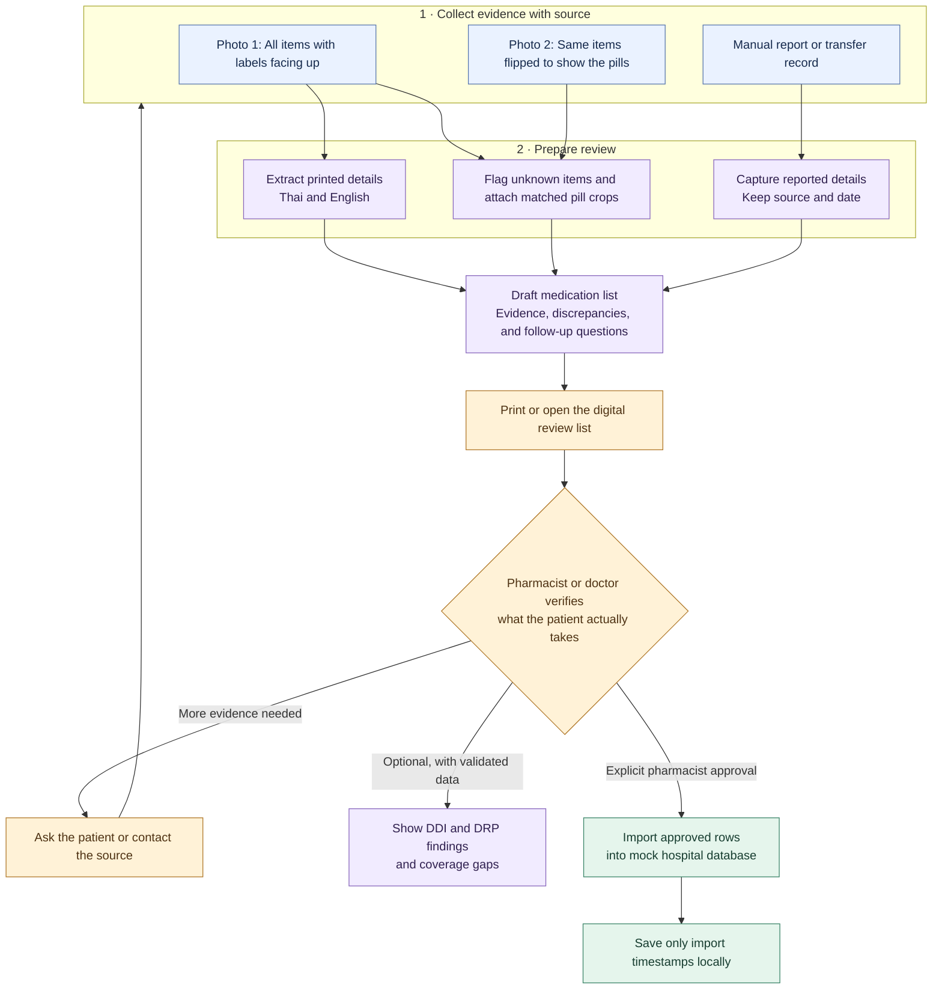

# Medication reconciliation v1 design

## Problem and users

ช่วยเภสัชกรรวบรวมประวัติยาจากหลายแหล่งก่อนส่งต่อหรือสั่งยาครั้งถัดไป เอกสารอาจมาไม่ครบ ผู้ป่วยอาจนำยามาเพียงบางส่วน และเภสัชกรต้องกรอกข้อมูลซ้ำจากคลินิก โรงพยาบาล หรือหอผู้ป่วย

Build a 12-hour, fixture-only web demo for hospital and community pharmacists, doctors, and authorized clinic staff. It turns two photos into a source-linked medication reconciliation draft for transfers, handoffs, and urgent intake. A pharmacist or doctor uses the draft to verify what the patient actually takes. Keep printed directions, reported use, and reviewer-verified current use distinct. [WHO technical report on medication safety in transitions of care](https://www.who.int/publications/i/item/WHO-UHC-SDS-2019.9)

## Workflow

1. A staff member opens a transient case. For **Photo 1**, arrange all the patient's medicines together on a plain background, including bags, boxes, blister packs, and loose or unlabeled items. Face the labels up and make the text readable in the frame. For **Photo 2**, flip the same bags or packs to show the pills where visible. Keep the items in their original positions so the two photos can be matched. Allow either photo to be retaken. Attach a source to each photo or supplemental manual record. Capture the evidence type, organization or reporter, department or ward, contact, and source date when available. Flag missing source details for follow-up. The demo uses `ศักดาเวชการ` and the masked contact `075-356XXXX`.
2. Automatically read Thai, English, and bilingual labels from **Photo 1** and give each item or inseparable group one draft row. Capture the medication name, dose, indication, regimen or directions, amount prescribed, prescriber, and prescriber contact when explicitly documented. Also capture strength, dosage form, and expiry when visible. Preserve the original text, numerals, units, and dates and link each field to its evidence. Keep the dose separate from product strength and the amount prescribed separate from the number of pills visible. Leave missing or unreadable fields blank and allow the reviewer to fill them from a documented source. Do not infer indication, prescriber identity, or contact details.
3. Give unlabeled items and items whose identity is unreadable a stable placeholder such as **Unknown medication A**, with an **Unlabeled** or **Unreadable** status. Match the same item across the photos and attach its crop from **Photo 2** when the match is supported. If pills are hidden or the match is uncertain, keep the row pending and ask the reviewer to match the images or retake the photo. A reviewer may inspect loose-pill descriptors and synthetic reference candidates. Require independent evidence to confirm identity.
4. Show conflicting values side by side with their sources and ask for the specific missing evidence. Include manual additions for medicines the patient reports but did not photograph. Provide the same dated draft as a digital review list and a print-friendly list. Both show medication details, evidence references, reported use, discrepancies, follow-up items, and each matched Photo 2 crop beside its unknown item. Show a missing-image note when a crop is unavailable. The print layout includes space for verification and notes. The digital view links back to the photos and supports corrections. Drafts and unresolved rows carry visible status labels in both formats.
5. A pharmacist or doctor reviews the list with the patient or caregiver and uses other source records as needed. For each row, confirm identity and record whether the patient currently takes it, no longer takes it, or has uncertain use. For current medications, record the actual dose, route, and frequency as verified, separately from the printed directions. Record who verified the row, when, and which evidence supports it. Keep unresolved discrepancies pending and record any medicines missing from the photos. Clinical decisions and advice remain with the reviewer.
6. The existing mock hospital import requires explicit pharmacist approval and valid source evidence for every selected row. Keep ineligible rows pending and show what remains after a partial import. Return the mock hospital's UTC import timestamp after success and save only that timestamp in local history. Timestamp searches may return multiple results for staff to disambiguate. Reloading restores the history and clears the draft.

## Optional DDI and DRP summaries

The reviewer can request either a drug–drug interaction (DDI) summary or a drug-related problem (DRP) summary. The two-photo draft, the reviewer handoff, and pharmacist approval work with both summaries off. Enable a check only when a versioned, clinically validated reference or rule set is available for the intended scope. DDI checks require reviewer-verified current medications with supported normalized identities. DRP checks also require the verified regimen and any patient context specified by each rule. The model transcribes evidence and does not generate clinical findings. Synthetic fixtures can demonstrate the interface with simulated findings clearly labeled as demo data.

- Show the source or rule-set name and version, when the checks ran, the medications or pairs actually evaluated, and the DRP rules applied. Tie each possible finding to the affected rows and its supporting source or rule.
- Report skipped medications, pairs, or rules with reasons such as unresolved identity, missing patient context, unsupported products, or an unavailable or stale source. Distinguish **Not run**, **Unavailable**, **Partial coverage**, and completed checks. State “No findings within checked scope” only for the portion that actually ran and display any gaps alongside it. Keep medication verification independent of the summary and reserve completion status for the reviewer's own verification.
- Invalidate the summary when its medication list or required context changes. An exported summary, when the reviewer chooses to include it, carries the same scope, provenance, and gaps. The reviewer decides clinical relevance and any follow-up or treatment changes.

## Architecture and data ownership

| Component | Responsibility |
| --- | --- |
| Next.js App Router and TypeScript | Staff-facing intake and review workspace. Draft photos, field values, and review edits live in memory. Use a local demo reviewer identity on the server for the pharmacist role. |
| Server-side OpenAI adapter | Sends synthetic fixture photos for label transcription and appearance description. Validates structured responses against the shared contract. The key stays server-side. Use stateless requests with response storage disabled where supported. Review provider data controls before any real-data integration. [OpenAI API data controls](https://developers.openai.com/api/docs/guides/your-data) |
| Candidate search | Rank a small bundled catalog of fictional reference images using image similarity and observed imprint, shape, form, and color. Use known crops or manual selection for the demo. Return multiple plausible results or an unresolved state. |
| Import service and mock hospital DB | Validates approved rows and evidence server-side and writes the accepted snapshot to a fixture-only mock receiving system. Retries of the same approved import return the original timestamp without duplicate writes. A failed write leaves the draft available for retry and creates no local history entry. |
| Browser history | Store only successful UTC timestamps. Omit case UUIDs, filenames, source names, contacts, medication fields, images, and chat transcripts. Keep those fields out of persistent browser storage, caches, analytics, and app logs. The mock hospital DB is the only demo store for reviewed medication records. |

## Demo scope

Demonstrate one transfer case with the label-side and reverse-side photos of the same items. Read a Thai/English label into the draft, leave an unreadable field blank, and show an unlabeled item with its reverse-side crop in both review formats. Include a difference between printed directions and what the patient reports. Verify that the reviewer can record actual use and that one approved row can be imported while a pending row stays out. With both summaries off, the review still works. A synthetic partial-coverage example shows a checked pair or rule, an omitted item, and the reason for the omission. Use synthetic fixtures throughout. Production authentication and hospital connectivity, clinic-specific rule sets, live DDI and DRP integrations, automated urgency assessment, symptom-based identification, and longitudinal medication histories are future work.

## Hackathon judging and demo acceptance

Use the working prototype to show how a pharmacist or doctor prepares and verifies a transfer medication list from incomplete evidence. Prioritize the complete two-photo workflow and printable handoff within the 12-hour demo budget. Show the optional DDI/DRP example after the core workflow.

| Judging criterion | Evidence to show |
| --- | --- |
| Problem & Solution Fit | Use a synthetic transfer case with a dispensing label, an unlabeled medicine, and a discrepancy between printed directions and patient-reported use. Show how the draft brings those sources together and gives the reviewer a specific follow-up for each gap. Ground the problem statement in medication reconciliation at transfers of care. |
| Build Quality | Run the two-photo flow from a fresh session through extraction, unknown-item review, verification of actual use, and the digital and printed handoff. Exercise the recovery checks below, and verify that judges can open the submitted prototype link. Label simulated DDI/DRP findings and mock hospital behavior in the demo. |
| Insight & Originality | Show the two-photo capture pattern in action. A matched reverse-side crop stays attached to a stable unknown-item row through the printed and digital handoff, so the reviewer can identify which physical item needs follow-up. Show how the draft keeps label directions, patient reports, and reviewer-verified use separate. |
| Real-World Value | Identify the beneficiaries and the work the prototype could save. Compare manual draft preparation with app-assisted preparation on the same synthetic case. Record time to prepare a reviewable draft, fields corrected by the reviewer, and unresolved items surfaced. Report the measured results and label them as a synthetic-case demonstration. |
| Alignment with Build Direction | Select at least one official build direction and tie it to a behavior judges can try. The proposed fit is AI-assisted intake with clinician verification, demonstrated by the two-photo draft and review. Confirm the official direction name from the event materials before finalizing the write-up. |
| Use of Codex | Show specific contributions from Codex to building the product. Record what Codex did, the resulting change or test, and how the team verified it. Use actual examples linked to commits or diffs where available. |

Use the following checks when implementing and verifying the demo. The issue numbers refer to the existing work areas below.

| Check | Acceptance criteria and work area |
| --- | --- |
| Photo pairing and recovery | Cover swapped positions, hidden pills, and a retake. Uncertain pairings keep the unknown row pending without attaching a crop. Retakes refresh affected matches and preserve unrelated draft entries. Intake and review (#11, #12, #15), verified end to end (#16). |
| Print and digital review | Both formats show the same unknown rows and matched crops. The digital review records who verified actual use and when. The printed list has room for reviewer notes. Review and workspace (#12, #15), verified end to end (#16). |
| Optional DDI/DRP example | With both summaries off, complete the review. When a simulated check runs, show checked scope, skipped items or rules, and the reason. Editing the medication list or required context invalidates the result. Workspace (#15), verified end to end (#16). |
| Mock import recovery | Import only pharmacist-approved rows, keep unresolved rows visible, and recover from a failed write without duplicate records. Approval and import (#10, #13, #15), verified end to end (#16). |

## Hackathon submission requirements

The Regional Codex Hackathon Thailand submission slide calls for **one Google Form submission per team by 5:00 PM local event time** and states that late submissions are disqualified. Have one team member coordinate the submission using the organizer's form.

| Deliverable | Ready when |
| --- | --- |
| GitHub repository | The submitted link opens a **new public repository created for this hackathon**. Verify that a signed-out visitor can open it and that the public contents contain synthetic fixtures only, with no credentials or patient data. `pakornds/Medication-Reader` is the intended destination, subject to eligibility and visibility verification. |
| Project write-up | The write-up explains the medication reconciliation problem, the two-photo solution, the selected official build direction, and how Codex contributed. It includes observed demo results and distinguishes simulated findings from live features. |
| Demo link | The link opens a live demo or working prototype that judges can use to run the synthetic case. Verify access and the core workflow from a fresh browser session before submission. |
| Declarations | Identify any existing open-source software or personal projects used and state which work was built exclusively during the event. Record the copied `Medication-Reader-Agent` baseline at `d6a81c9`, identify which parts were reused, and confirm the event-only work against the project history. |

## GitHub tickets

The scaffold and shared contracts are separate prerequisites. Once both merge, feature agents can use the same types, examples, and fixtures while owning distinct paths.

| Ticket | Depends on | Owned paths | Acceptance criteria |
| --- | --- | --- | --- |
| [#2](https://github.com/pakornds/Medication-Reader-Agent/issues/2) Scaffold Next.js and verification tooling | None | Initial Next.js scaffold, root package manifest and lockfile, tooling, CI, AGENTS.md Commands subsection | From a clean checkout, the documented install, test, lint, type-check, and run commands succeed. The starter page responds successfully and CI runs the documented checks. |
| [#3](https://github.com/pakornds/Medication-Reader-Agent/issues/3) Define reconciliation contracts and shared fixtures | [#2](https://github.com/pakornds/Medication-Reader-Agent/issues/2) | `src/lib/reconcile-contract.ts`, `tests/fixtures/contracts/`, `docs/specs/reconciliation-contract.md` | Shared types and fixtures cover Thai/English transcription, mixed pills, conflicting or missing evidence, approved import, failure, and timestamp receipt. All fixtures type-check and exercise documented interfaces. |
| [#4](https://github.com/pakornds/Medication-Reader-Agent/issues/4) Add mockable server-side OpenAI adapter | [#3](https://github.com/pakornds/Medication-Reader-Agent/issues/3) | `src/lib/ai/`, `tests/ai/` | With a fake transport, the adapter returns structured output and maps timeout or provider failure to contract errors. Tests verify request policy without live credentials and client code cannot import the adapter. |
| [#5](https://github.com/pakornds/Medication-Reader-Agent/issues/5) Transcribe packaging and label evidence | [#4](https://github.com/pakornds/Medication-Reader-Agent/issues/4) | `src/app/api/evidence/labels/`, `src/lib/evidence/labels/`, `tests/evidence/labels/` | A bilingual fixture preserves both printed names and units, marks smudged expiry unreadable and absent directions missing. Invalid uploads and malformed model output return contract errors. |
| [#6](https://github.com/pakornds/Medication-Reader-Agent/issues/6) Describe loose pills from selected crops | [#4](https://github.com/pakornds/Medication-Reader-Agent/issues/4) | `src/app/api/evidence/pills/`, `src/lib/evidence/pills/`, `tests/evidence/pills/` | A two-crop fixture returns distinct observations; a partially hidden imprint stays unknown and an overlapping group asks for a clearer photo. No inferred identity appears in the output. |
| [#7](https://github.com/pakornds/Medication-Reader-Agent/issues/7) Rank synthetic pill references | [#3](https://github.com/pakornds/Medication-Reader-Agent/issues/3) | `src/app/api/evidence/pill-candidates/`, `src/lib/evidence/catalog/`, `fixtures/catalog/`, `tests/evidence/catalog/` | Synthetic fixtures demonstrate the effect of image similarity and descriptor changes on ranking. Similar references remain multiple unverified candidates; an unmatched crop yields an unresolved result and a follow-up. |
| [#8](https://github.com/pakornds/Medication-Reader-Agent/issues/8) Validate pharmacist approval and source evidence | [#3](https://github.com/pakornds/Medication-Reader-Agent/issues/3) | `src/lib/import-eligibility/`, `tests/import-eligibility/` | Tests reject non-pharmacists, missing or stale approval, untraceable source, unresolved identity, and unresolved conflicts. Candidate similarity alone stays ineligible. A properly reviewed row passes. |
| [#9](https://github.com/pakornds/Medication-Reader-Agent/issues/9) Store retry-safe records in the mock hospital | [#3](https://github.com/pakornds/Medication-Reader-Agent/issues/3) | `src/lib/hospital/`, `tests/hospital/` | Concurrent retries with the same token and snapshot return the original timestamp and create one record; a failure creates no record. Timestamp lookup returns all exact matches. A token reused with conflicting content fails. |
| [#10](https://github.com/pakornds/Medication-Reader-Agent/issues/10) Connect approvals to the mock hospital import route | [#8](https://github.com/pakornds/Medication-Reader-Agent/issues/8), [#9](https://github.com/pakornds/Medication-Reader-Agent/issues/9) | `src/app/api/import/`, `tests/import/` | An approved subset writes and returns only its receipt. A request containing an ineligible selected row writes nothing. Store failure produces a reviewable error without a receipt. Pending unselected rows stay out of the payload. |
| [#11](https://github.com/pakornds/Medication-Reader-Agent/issues/11) Build source-aware evidence intake UI | [#3](https://github.com/pakornds/Medication-Reader-Agent/issues/3) | `src/components/intake/`, `tests/ui/intake/` | Using fixture clients, all three evidence paths work. Missing required source details are shown without losing the draft. Invalid upload and retry feedback are visible and entered source details survive a recoverable error. |
| [#12](https://github.com/pakornds/Medication-Reader-Agent/issues/12) Build discrepancy and candidate review UI | [#3](https://github.com/pakornds/Medication-Reader-Agent/issues/3) | `src/components/review/`, `tests/ui/review/` | A synthetic conflict displays both source-linked strengths and separates reported use from documented directions. Candidate details show reference images and matched/different attributes. A descriptor edit invokes the supplied callback. |
| [#13](https://github.com/pakornds/Medication-Reader-Agent/issues/13) Build pharmacist approval and import preview UI | [#3](https://github.com/pakornds/Medication-Reader-Agent/issues/3) | `src/components/approval/`, `tests/ui/approval/` | The preview excludes unresolved or unselected rows, shows reviewer and source, and requires confirmation before calling import. An edit clears approval. Failed imports preserve the draft and show retry feedback. |
| [#14](https://github.com/pakornds/Medication-Reader-Agent/issues/14) Persist timestamp-only import history | [#3](https://github.com/pakornds/Medication-Reader-Agent/issues/3) | `src/lib/history/`, `src/components/history/`, `tests/ui/history/` | A successful receipt survives reload as only its timestamp; failure adds nothing and a repeated receipt adds no duplicate entry. Storage tests check that evidence, source, file and case details are absent. |
| [#15](https://github.com/pakornds/Medication-Reader-Agent/issues/15) Assemble the reviewer workspace | [#5](https://github.com/pakornds/Medication-Reader-Agent/issues/5), [#6](https://github.com/pakornds/Medication-Reader-Agent/issues/6), [#7](https://github.com/pakornds/Medication-Reader-Agent/issues/7), [#10](https://github.com/pakornds/Medication-Reader-Agent/issues/10), [#11](https://github.com/pakornds/Medication-Reader-Agent/issues/11), [#12](https://github.com/pakornds/Medication-Reader-Agent/issues/12), [#13](https://github.com/pakornds/Medication-Reader-Agent/issues/13), [#14](https://github.com/pakornds/Medication-Reader-Agent/issues/14) | `src/app/page.tsx`, `src/lib/workspace/`, `tests/workspace/` | A synthetic case combines Thai and English evidence and imports a reviewed row while an unverified pill stays pending. A failed import keeps the draft available for retry. Reload restores timestamps only. Urgency never bypasses approval. |
| [#16](https://github.com/pakornds/Medication-Reader-Agent/issues/16) Verify the end-to-end reconciliation demo | [#15](https://github.com/pakornds/Medication-Reader-Agent/issues/15) | `tests/integration/` | Automated checks cover bilingual input, conflicting strengths, missing source, unresolved candidates, rejected approval, failure and retry, reload, and timestamp lookup. Document the actual commands and results in the PR. |

**Merge order.** Merge [#2](https://github.com/pakornds/Medication-Reader-Agent/issues/2) and then [#3](https://github.com/pakornds/Medication-Reader-Agent/issues/3). After that, the adapter, catalog search, import eligibility, mock store, and four UI or history tickets can run in parallel. Label transcription and pill observation follow the adapter. The import route follows both import eligibility and the mock store. Merge the workspace after its feature dependencies, then run the end-to-end ticket. The `Depends on` links enforce this order, so `Merge after` is `none` for these issues.

The one-day demo budget stays the same. Use the [agent workflow](../../AGENTS.md) for separate worktrees and verified merges. The [AI behavior contract](../ai/reconciliation-behavior.md) supplies test cases and model constraints.
